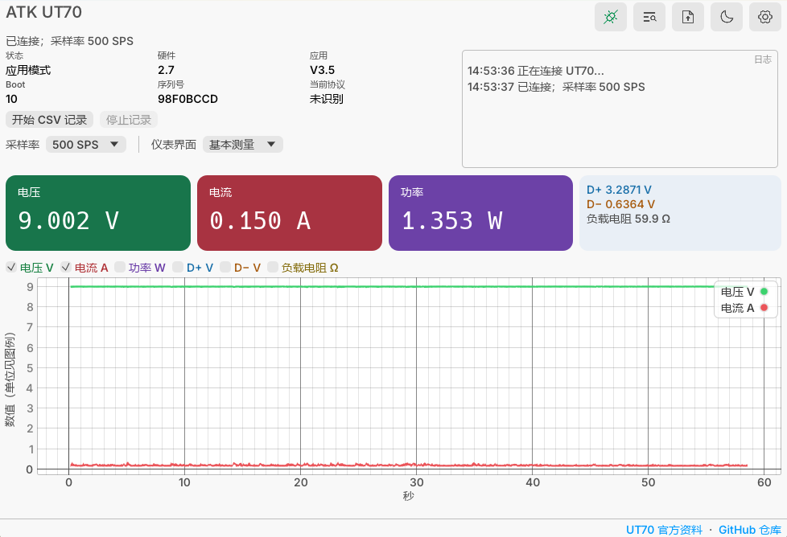

# ATK-UT70-RS


正点原子 UT70 的跨平台上位机。启动时尝试连接仪表侧面的 USB HID 口，读取电压、电流、D+/D−，绘制可选时间范围内的曲线；可选择显示功率、按 `V/I` 计算的负载电阻，以及累计电量 mAh 和能量 Wh。支持调整采样率、记录完整 CSV、主动扫描供电端快充协议，并通过独立的“固件更新”窗口读取本地官方 `.atk` 文件烧录固件。界面可切换简体中文和 English、明暗色主题；使用 Rust、egui 和 egui_plot，HID 使用 hidapi。无需官方 Windows DLL。



此仓库包含[逆向后的 HID 接口文档](docs/PROTOCOL.md)和客户端源码，不包含官方程序、固件、USB 抓包或个人测试日志。协议来自一台硬件 2.7、应用 V3.5 的 UT70；其他版本还需实机验证。已知限制与验证状态见[文档](docs/PROTOCOL.md#验证边界)。

项目代码及文档采用 [GPL-3.0-only](LICENSE)；Phosphor 图标和 Inter 字体分别保留各自的 [MIT](assets/icons/LICENSE.phosphor) 与 [SIL OFL 1.1](assets/fonts/OFL.Inter.txt) 许可。下载包附带许可证文本，完整源码位于此仓库对应版本的 Git 标签。

界面右下角可打开本项目 GitHub 仓库和[正点原子 UT70 官方资料页](https://www.openedv.com/docs/tool/USB/usb.html)。

## 下载与运行

GitHub Actions 的 **Build desktop client** 工作流为以下架构生成独立产物，见每次构建的 Artifacts：

| 系统 | 架构 | 产物 |
| --- | --- | --- |
| Windows | x86_64、aarch64 | `.zip`，内含 `.exe` |
| macOS | x86_64、aarch64 | `.zip`，内含 `.app` |
| Linux | x86_64、aarch64 | `.AppImage`、`.deb`、`.rpm` |

运行前连接 UT70 侧面 HID 口，关闭同时占用设备的官方客户端；软件启动时自动尝试连接，未连上时可点击“连接设备”重试。Linux 用户需要 HID 设备访问权限；常见发行版可创建 udev 规则：

```text
SUBSYSTEM=="hidraw", ATTRS{idVendor}=="19f5", ATTRS{idProduct}=="6666", TAG+="uaccess"
```

规则生效后重新插拔 HID 线。AppImage 还需要系统提供图形驱动及 USB/HID 相关基础库。`.deb`、`.rpm` 安装程序及桌面图标；两个安装包目前由 Ubuntu 24.04 构建机打包，仍需在目标发行版实机验证。

macOS 构建包使用 ad hoc 签名并校验签名和 ZIP 完整性，但没有 Apple Developer ID 签名及公证。若从 GitHub 下载后 Finder 提示“已损坏”，确认来源是本仓库的 Actions 产物后，在终端仅对解压出的本应用清除下载隔离属性，再打开：

```sh
xattr -dr com.apple.quarantine /path/to/ATK-UT70-RS.app
open /path/to/ATK-UT70-RS.app
```

请把 `/path/to/ATK-UT70-RS.app` 换成实际路径；不需要修改系统的 Gatekeeper 设置。要让下载包直接通过 Gatekeeper，需要 Apple Developer ID 签名及公证。

### 从源码构建

安装 Rust 稳定版和系统原生编译工具后：

```sh
cargo test --locked
cargo run --release
```

Linux 还需要 `libudev-dev`、`libxkbcommon-dev`、`libwayland-dev`、X11、GTK3 和 DBus 的开发包；具体安装命令见 [GitHub Actions 工作流](.github/workflows/build.yml)。Windows 需要 MSVC C++ Build Tools。

在本机 Windows x64 构建并把可执行文件复制到外层 `UT70` 目录，可运行 `powershell -NoProfile -ExecutionPolicy Bypass -File scripts/build-local-windows-x64.ps1`；输出文件名为 `ATK-UT70-RS-windows-x86_64.exe`。

## 使用范围

- 测量：4、10、50、200、500、1000 SPS；电压、电流和功率以大字显示，六条瞬时量曲线共用主图。累计电量和能量按每点 `I/(3600×SPS)` Ah、`V×I/(3600×SPS)` Wh 积分，显示为 mAh 和 Wh，数值与电阻、D+/D−、纹波一同放在双列信息区。两项曲线默认不勾选；勾选后在主图中以浅色填充区域显示，不绘制边线。测量帧不直接包含这两个累计值。负载电阻为 `V/I`，电流不高于 1 mA 时不绘制；它不是仪表“线阻模式”的线阻。纹波（参考）显示最近 1 秒电压采样的峰峰值 `max(V)−min(V)`，单位 mV；按说明书建议设为 1000 SPS，仅供辅助分析。每个收到的测量点写入 CSV。
- 界面：顶部显示设备信息、事件日志和实时读数；标题下不重复显示最新日志，断开时信息栏显示占位值。连接状态由插头图标按钮切换，齿轮按钮打开设置，太阳或月亮按钮切换明暗色主题；语言、主题、光标数值开关和横轴时间范围会保存在本机。横轴可选 1、5、10、30 秒、1 分钟、10 分钟、1 小时或全部，默认 30 秒；打开光标数值后，十字线会显示最近采样点的已选曲线数值。曲线随窗口大小填充剩余区域。协议检测从主窗口右侧展开，按协议显示检测方块，检测到支持时点亮；点击方块查看设备报告的档位文字。
- 曲线控制：“重新开始”清空曲线并将 mAh/Wh 累计值归零；“暂停”冻结界面读数和曲线，后台仍继续累计和写入 CSV，恢复后显示完整历史。CSV 开始和停止共用一个按钮。最近 1 分钟保留原始采样点；更早的数据按时间桶保留各曲线峰谷，桶数到上限时逐级合并，所以“全部”覆盖整个采集时间轴，而内存和每次绘图点数有上限。长时间范围的光标读数取时间桶代表点，以 `≈` 标识。CSV 仍保存全部采样点，长时间记录会增加磁盘占用。
- 协议检测：点击右上角的扫描图标展开右侧面板，不会立即检测。移除负载后点击面板中的“开始检测”，协议方块会逐项更新；点击方块可看设备报告的电压/电流档位。检测会执行快充握手并可能改变被测端口电压，带载检测可能损坏设备。已在 Windows 官方 DLL、USB 抓包和 Rust HID 实机扫描中验证；macOS、Linux 上的扫描还需实机验证。
- 界面切换：下拉框包含手动触发、自动检测、线阻模式、DASH 检测和 E-Marker 检测。线阻模式使用 `EE 03 04 12 01 01 01 0A FF` 切换；此前 Windows 上曾在进入该模式后报告 USB 异常，因此发送后不等待进一步查询。自动检测会先弹出移除负载警告；手动触发和自动检测属于有状态操作，发送指令后以仪表显示为准。远程切换 E-Marker 曾让仪表白屏或自行重启，选择该项会先弹出警告，只有确认后才发送指令；手动检测的稳定性仍待验证，线缆详情尚未在 HID 中观察到。“其他”不可远程切换。仪表按键产生的界面上报会同步到下拉框，未列出的编号显示为“其他”；手动更改采样率的上报也会同步到 SPS 下拉框。立即回读编号不能证明模式长期稳定。
- 固件：先拔下 HID 线，按住仪表右键再插入，点击“连接设备”确认进入升级模式，再从“固件更新”窗口选择匹配当前硬件的官方 `.atk` 文件。客户端校验文件类型、长度、设备类型和硬件版本；每包检查回复，结束后确认设备重启及应用版本。固件文件必须由用户自行从官方渠道取得。升级过程中保持供电和 HID 连接。
- “波形显示”状态下版本查询曾超时，但测量帧仍继续。客户端连接时即使版本查询失败也会尝试接收测量；此时显示的采样率可能是默认值，直到再次成功查询或设置。

目前 Rust 客户端的协议单元测试与编译结果不能替代三平台实机验证。已有 Python 参考实现曾在 Windows、macOS、Linux 验证实时采集，并在 Windows、macOS 验证同版本烧录；Rust 移植后的烧录还需要独立实机验证。详见[升级协议](docs/FIRMWARE.md)。
